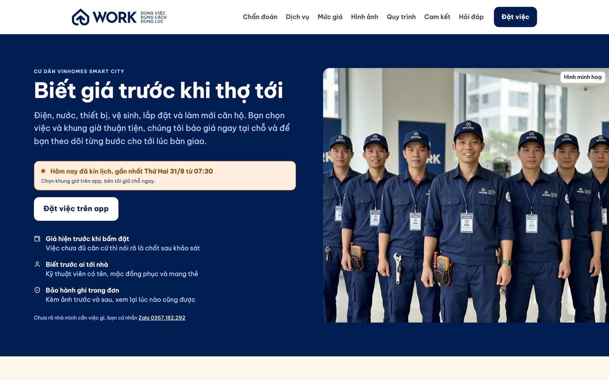
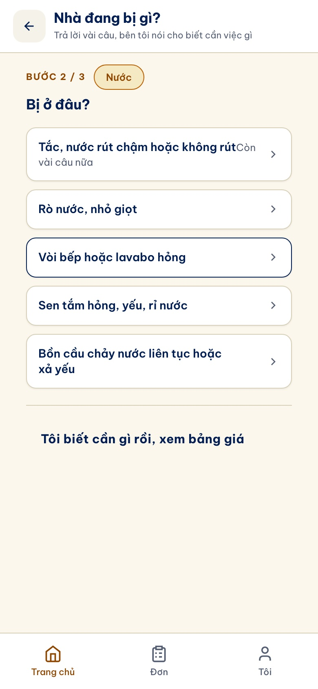
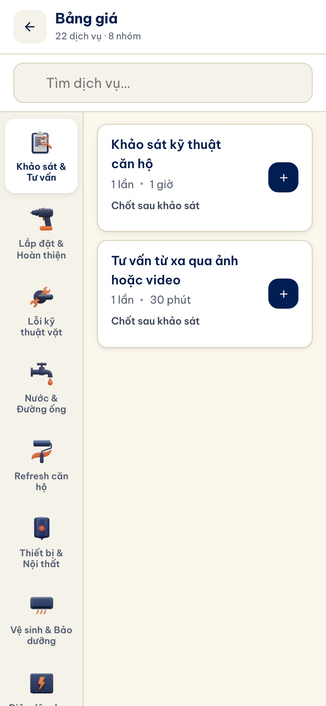
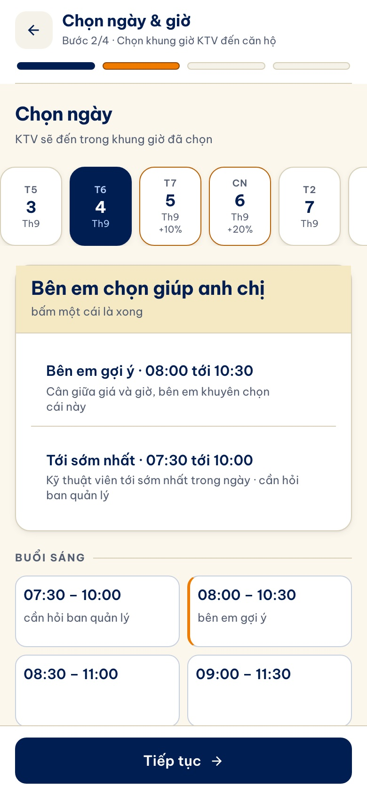

# kythuat.work · designed by Sinh Vũ Studio

[Tiếng Việt](README.md)

kythuat.work is an in-apartment repair and installation service (electrical, plumbing, appliances, cleaning, fitting and apartment refresh) for residents of Vinhomes Smart City, Hanoi.

Sinh Vũ designed the whole product: brand identity, landing page, three apps for three groups of users, the day-to-day operating model, and built the system that runs behind it.

This repository is a **showcase**. It holds a design system anyone can reuse, plus screenshots and the key design decisions. The full source (server, database, three apps, test suites) is open at [kythuat-work](https://github.com/ideasv/kythuat-work) under AGPL-3.0, with synthetic data in place of real data.

> kythuat.work is currently closed to customers and not yet officially operating.
> Full project story: [sinhvu.com/en/case/kythuat-work](https://sinhvu.com/en/case/kythuat-work/)



## The problem

When residents let a repair person into their home, they worry about three things: what it will cost, who will show up, and who to hold responsible if it breaks again.

The service previously ran on Google Sheets plus hand-written automation scripts. That worked at low volume but was hard to scale and easy to break when several people edited at once.

Sinh Vũ answered those three worries with three promises printed on the first screen, then designed the whole system to keep them:

- **The price shows before you book.** When a job cannot be priced without seeing it, the app says so: price confirmed after the site survey.
- **You know who is coming.** Technicians are named, in uniform, and wear an ID card.
- **The warranty is written into the order,** with before and after photos you can check any time.

## Three apps, one system

| App | Used by | Purpose |
|---|---|---|
| Customer app | Residents | Describe the problem, see the price, pick a time, track the order |
| Technician app | Technicians | Accept jobs, take before and after photos, log materials used |
| Dispatch console | Dispatchers, accountants | Approve orders, assign technicians, track money |

All three apps share one design system and one data source, so residents, technicians and dispatchers always see the same order status, called by the same name.

## Key design decisions

**1. Ask "What is wrong at home?" instead of making people pick a service name.** Residents often do not know what their job is called. The app asks three short questions, such as whether it is electrical or plumbing and where the problem is, then suggests the right job.



**2. A price list grouped with pictures.** Twenty-two services in eight groups, each with an illustration you recognise at a glance. Jobs that need a site visit say "price confirmed after survey" instead of showing a made-up number.



**3. Choose the time for the customer.** Instead of twenty time slots, the app leads with two options: the recommended slot and the earliest arrival. One tap and done. Weekend surcharges are shown right on the date.



**4. Words and money are computed in one place.** Status text (for example "Completed") and every money figure come from the server. The apps never copy or recalculate them, so the three apps never contradict each other.

**5. The apps carry their own fonts.** Technicians often work in basement car parks with weak signal, so fonts ship inside the app instead of loading from an outside server, and text never breaks when the connection drops.

## Design system (free to reuse)

The [`he-thiet-ke/`](he-thiet-ke/) folder ("design system" in Vietnamese) contains:

| File | What it is |
|---|---|
| `design-system.css` | Colour, type scale, spacing, radius and UI components. Over 300 design tokens (named values such as `--kt-brand-500`) in three tiers: base values, roles, components. Comments in the file (in Vietnamese) explain the reasoning. |
| `tokens.w3c.json` | 237 tokens in the W3C Design Tokens format, importable into Figma via plugin. |
| `tokens-ramps.json` | Parameters for generating the OKLCH colour ramps, so light and dark steps look evenly spaced to the eye. |
| `icons.svg` | 56 icons on a 24 px grid, 2 px stroke. |

Quick start:

```html
<link rel="preconnect" href="https://fonts.googleapis.com">
<link href="https://fonts.googleapis.com/css2?family=Be+Vietnam+Pro:wght@400;500;600;700&display=swap" rel="stylesheet">
<link rel="stylesheet" href="he-thiet-ke/design-system.css">

<svg width="24" height="24"><use href="he-thiet-ke/icons.svg#kt-house"></use></svg>
```

Be Vietnam Pro is an open font under the SIL Open Font License, free on Google Fonts.

## Licence

- Code in `he-thiet-ke/`: [MIT](LICENSE). Use and modify freely, including commercially, keeping Sinh Vũ's copyright notice.
- README text and images in `anh/`: [CC BY-NC 4.0](LICENSE-NOI-DUNG.md). Share and quote with credit to Sinh Vũ, non-commercial only.
- The kythuat.work and Sinh Vũ names and logos are not covered by either licence.

## About Sinh Vũ

Sinh Vũ Studio is a brand design studio in Hanoi. Sinh Vũ goes beyond the logo to where a brand actually runs: documents, websites, apps and daily operations.

- Website: [sinhvu.com/en](https://sinhvu.com/en/)
- More projects: [sinhvu.com/en/case](https://sinhvu.com/en/case/)
- Start a project: [sinhvu.com/lien-he](https://sinhvu.com/lien-he/)
