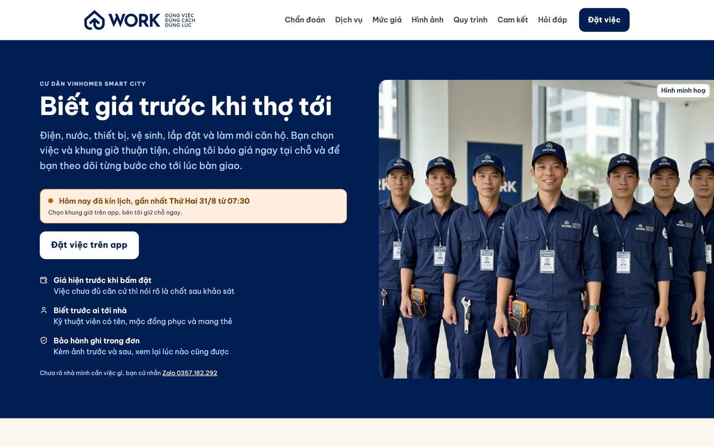
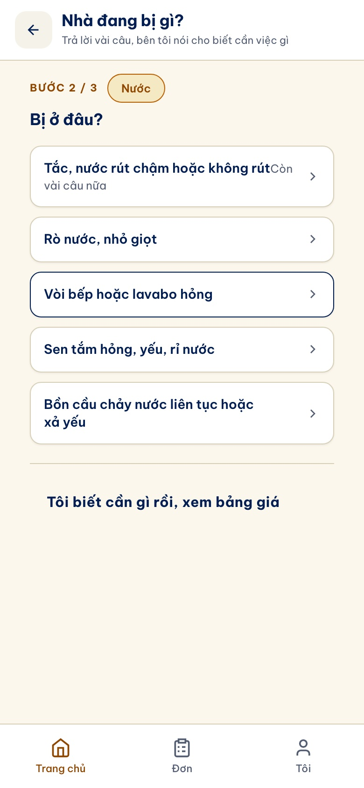
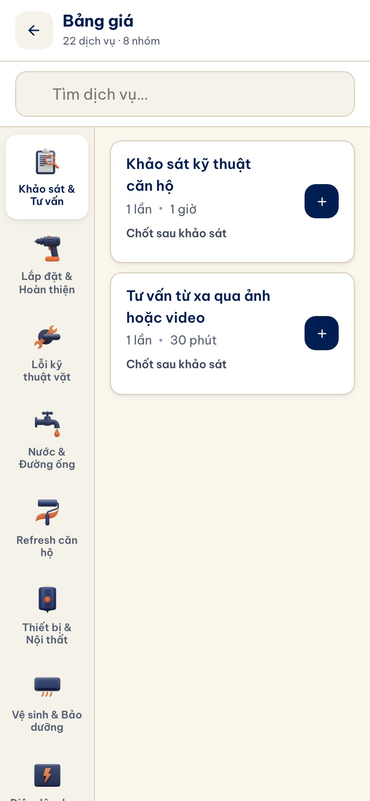
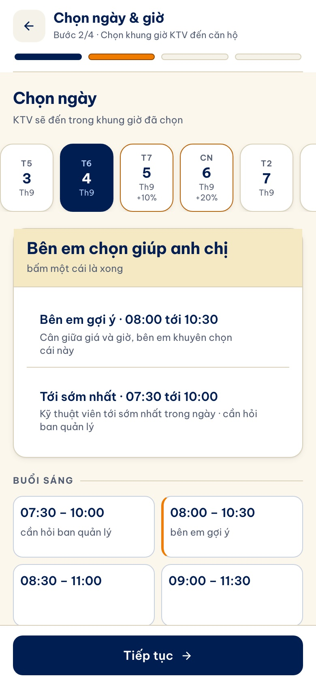

# kythuat.work · thiết kế bởi Sinh Vũ Studio

[English](README.en.md)

kythuat.work là dịch vụ sửa chữa và lắp đặt kỹ thuật trong căn hộ (điện, nước, thiết bị, vệ sinh, lắp đặt và làm mới căn hộ) cho cư dân Vinhomes Smart City, Hà Nội.

Sinh Vũ làm trọn sản phẩm này: nhận diện thương hiệu, trang giới thiệu, ba ứng dụng cho ba nhóm người dùng, cách vận hành hằng ngày, và tự dựng hệ thống chạy phía sau.

Kho này là **bản trưng bày**. Ở đây có hệ thiết kế để ai cũng lấy về dùng được, kèm ảnh màn hình và những quyết định thiết kế chính. Toàn bộ mã nguồn của hệ (máy chủ, cơ sở dữ liệu, ba ứng dụng, bộ đo) được mở ở kho [kythuat-work](https://github.com/ideasv/kythuat-work), giấy phép AGPL-3.0, với dữ liệu giả thay cho dữ liệu thật.

> Hiện kythuat.work đang tạm đóng cửa với khách, chưa hoạt động chính thức.
> Câu chuyện đầy đủ của dự án: [sinhvu.com/case/kythuat-work](https://sinhvu.com/case/kythuat-work/)



## Bài toán

Mời thợ vào nhà, cư dân thường lo ba điều: không biết trước sẽ tốn bao nhiêu tiền, không biết ai sẽ tới nhà mình, và hỏng lại thì không biết đòi ai.

Trước đó, dịch vụ chạy trên Google Sheets (bảng tính) cộng các đoạn mã tự động viết tay. Cách này đủ dùng khi ít đơn, nhưng khó mở rộng và dễ rối khi nhiều người cùng sửa.

Sinh Vũ trả lời ba nỗi lo ấy bằng ba lời hứa in ngay ở trang đầu, rồi thiết kế cả hệ thống để giữ được ba lời hứa đó:

- **Giá hiện ra trước khi bấm đặt.** Việc nào chưa đủ căn cứ để báo giá thì nói rõ là sẽ chốt giá sau khi khảo sát.
- **Biết trước ai tới nhà.** Kỹ thuật viên có tên, mặc đồng phục và đeo thẻ.
- **Bảo hành ghi ngay trong đơn.** Đơn có kèm ảnh trước và sau khi sửa, xem lại lúc nào cũng được.

## Ba ứng dụng, một hệ thống

| Ứng dụng | Ai dùng | Để làm gì |
|---|---|---|
| Cửa khách | Cư dân | Tả chỗ hỏng, xem giá, chọn giờ, theo dõi đơn |
| Cửa thợ | Kỹ thuật viên | Nhận việc, chụp ảnh trước và sau, ghi vật tư đã dùng |
| Trang điều phối | Người điều phối, kế toán | Duyệt đơn, giao việc cho thợ, theo dõi tiền |

Cả ba ứng dụng dùng chung một hệ thiết kế và một nguồn dữ liệu. Nhờ vậy cư dân, thợ và người điều phối luôn thấy cùng một trạng thái đơn, gọi bằng cùng một tên.

## Những quyết định thiết kế chính

**1. Hỏi "Nhà đang bị gì?" thay vì bắt khách chọn tên dịch vụ.** Cư dân thường không biết việc mình cần gọi là gì. Ứng dụng hỏi ba câu ngắn, ví dụ hỏng điện hay nước, hỏng ở chỗ nào, rồi tự gợi ý đúng việc cần đặt.



**2. Bảng giá theo nhóm, có hình.** Hai mươi hai dịch vụ chia thành tám nhóm, mỗi nhóm có một hình minh hoạ để nhìn là nhận ra. Việc nào phải xem tận nơi mới báo giá được thì ghi rõ "chốt sau khảo sát", không đưa ra một con số cho có.



**3. Chọn giờ giúp khách.** Thay vì bày ra hai chục khung giờ, ứng dụng đưa trước hai lựa chọn: khung giờ nên chọn nhất và khung giờ thợ tới sớm nhất. Khách bấm một lần là xong. Ngày cuối tuần có phụ phí thì ghi ngay trên ô ngày.



**4. Chữ và tiền chỉ tính ở một nơi.** Câu báo trạng thái đơn (ví dụ "Đã hoàn thành") và mọi con số tiền đều do máy chủ trả về, ứng dụng không tự chép hay tự tính lại. Nhờ vậy ba ứng dụng không bao giờ nói lệch nhau.

**5. Ứng dụng tự mang theo phông chữ.** Thợ hay làm việc dưới hầm xe, nơi sóng điện thoại yếu. Vì thế phông chữ nằm sẵn trong ứng dụng thay vì tải từ máy chủ ngoài, màn hình không bị vỡ chữ khi mạng chập chờn.

## Hệ thiết kế (lấy về dùng được)

Thư mục [`he-thiet-ke/`](he-thiet-ke/) gồm:

| Tệp | Là gì |
|---|---|
| `design-system.css` | Toàn bộ quy định hình thức: màu, cỡ chữ, khoảng cách, bo góc và các thành phần giao diện. Hơn 300 biến thiết kế (token, tức là giá trị có đặt tên, ví dụ `--kt-brand-500`), chia ba tầng: giá trị gốc, vai trò, thành phần. Các ghi chú trong tệp giải thích vì sao chọn như vậy. |
| `tokens.w3c.json` | 237 token viết theo chuẩn chung của W3C (tổ chức đặt chuẩn cho web), có thể nhập vào Figma qua plugin. |
| `tokens-ramps.json` | Tham số để sinh các thang màu theo hệ OKLCH, cách đo màu bám theo cảm nhận của mắt người, nhờ vậy các bậc sáng tối cách đều nhau. |
| `icons.svg` | 56 biểu tượng vẽ trên khung 24 điểm ảnh, nét dày 2. |

Cách dùng nhanh:

```html
<link rel="preconnect" href="https://fonts.googleapis.com">
<link href="https://fonts.googleapis.com/css2?family=Be+Vietnam+Pro:wght@400;500;600;700&display=swap" rel="stylesheet">
<link rel="stylesheet" href="he-thiet-ke/design-system.css">

<svg width="24" height="24"><use href="he-thiet-ke/icons.svg#kt-house"></use></svg>
```

Phông chữ Be Vietnam Pro là phông mở, giấy phép SIL Open Font License, tải miễn phí trên Google Fonts.

## Giấy phép

- Mã trong thư mục `he-thiet-ke/`: giấy phép [MIT](LICENSE). Được dùng, sửa, kể cả cho việc thương mại, miễn giữ dòng ghi bản quyền của Sinh Vũ.
- Chữ trong các tệp README và ảnh trong thư mục `anh/`: [CC BY-NC 4.0](LICENSE-NOI-DUNG.md). Được chia sẻ và trích dẫn kèm tên Sinh Vũ, không dùng cho việc thương mại.
- Tên và biểu tượng logo của kythuat.work và Sinh Vũ không thuộc hai giấy phép trên.

## Về Sinh Vũ

Sinh Vũ Studio là studio thiết kế thương hiệu ở Hà Nội. Sinh Vũ không chỉ vẽ logo mà làm tới chỗ thương hiệu chạy được thật: giấy tờ, trang web, ứng dụng và cách vận hành hằng ngày.

- Trang chủ: [sinhvu.com](https://sinhvu.com/)
- Các dự án khác: [sinhvu.com/case](https://sinhvu.com/case/)
- Liên hệ làm dự án: [sinhvu.com/lien-he](https://sinhvu.com/lien-he/)
